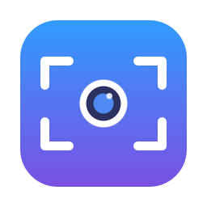

# Webcam Crop

[](https://github.com/ahmed-e-abdulaziz/webcam-crop/actions/workflows/ci.yml)
[](LICENSE)



A small macOS menu bar app that **crops and zooms your webcam (1–8×)** and sends the result to
your video calls through the **OBS Virtual Camera**, without running OBS.

I wrote it because my webcam has a wide, fish-eye lens. Cropping it in OBS worked, but running
all of OBS just to crop one camera is heavy. The camera's own zoom (UVC) also tops out far too
early. Webcam Crop does the crop on the GPU and hands the frames straight to the virtual camera
driver that OBS already installed.

## Features

- Zoom from 1× to 8× and place the frame anywhere: drag the box, click to jump, scroll or pinch to zoom.
- Live preview of the camera and of exactly what others will see.
- Works with any USB or built-in webcam; you choose which one.
- 720p or 1080p output at 30 fps.
- Lives in the menu bar: one switch to start or stop sending, a zoom slider, and open at login.
- Light on resources. Capture, crop and scale go through VideoToolbox on the GPU, then straight
  to the virtual camera. In testing this pipeline used about 7% of one CPU core (Apple Silicon,
  1080p in, 720p out, macOS video effects off).
- Everything stays on your Mac. No network access, no analytics.

## Requirements

- macOS 15 or later (Apple Silicon or Intel).
- [OBS Studio](https://obsproject.com) 30 or later, installed once for its virtual camera driver:
  1. Open OBS, click **Start Virtual Camera**, and allow the system extension in
     **System Settings › General › Login Items & Extensions** if asked.
  2. Click **Stop Virtual Camera** and quit OBS. You don't need to open it again, but keep it
     installed: deleting OBS removes the driver.
- Xcode Command Line Tools to build: `xcode-select --install`. The full Xcode is not needed.

## Install (build from source)

```sh
git clone https://github.com/ahmed-e-abdulaziz/webcam-crop.git
cd webcam-crop
./build.sh            # builds a universal app, signs it locally, installs to /Applications
open "/Applications/Webcam Crop.app"
```

On first launch macOS asks for camera access. Click **Allow**.

**Why there's no prebuilt download:** macOS blocks downloaded apps that aren't notarized by
Apple, and notarizing needs a paid developer account. Building locally avoids that. `build.sh`
creates a self-signed signing identity in `./signing/` the first time it runs. It lives in its
own keychain, separate from your login keychain, and it keeps the app's signature stable so
macOS remembers the camera permission across rebuilds. `signing/` is git-ignored; never commit it.

## Usage

1. Click the menu bar icon and turn on **Send cropped camera**.
2. Choose **Adjust framing…** to set the zoom and position with the live preview.
3. In Zoom, Meet, Teams or any other app, pick **OBS Virtual Camera** as the camera.

Keep the OBS app itself closed while using Webcam Crop. If OBS's own virtual camera is running,
it takes over the device.

## Tips & troubleshooting

- **Call app shows the OBS logo or a placeholder:** sending is off, or OBS is open. Check the
  status line in the menu.
- **High CPU use:** macOS **Video Effects** (Studio Light, Portrait, backgrounds) are applied
  per app, so they also apply to Webcam Crop. They show up in your call and can cost several
  times the app's own CPU use. The app warns you when one is on; **Video Effects…** opens
  Apple's controls.
- **Camera light always on:** with "Start sending when the app opens" and "Open at login" both
  on, the camera is in use whenever you're logged in. The OBS driver can't report when a call
  app is actually watching, so the app can't start and stop on its own. Use the menu bar
  switch instead.
- **Blurry at high zoom:** 8× uses a 240×135 patch of a 1080p camera. Above about 4× the picture
  gets noticeably soft.
- **Lower fps in dim light:** many webcams lengthen exposure and drop to about 20 fps in the dark.
- **Diagnostics:** settings are in `defaults read com.ahmedehab.webcamcrop`; the log is at
  `~/Library/Logs/WebcamCrop.log`.

## How it works

```
webcam ──AVFoundation──▶ 420v frames ──VideoToolbox (crop + scale + convert, GPU)──▶ UYVY
       ──CoreMediaIO sink stream──▶ OBS Virtual Camera system extension ──▶ your call app
```

- The crop is set as the source frame's *clean aperture*, so a single `VTPixelTransferSession`
  pass crops, scales and converts the pixel format.
- Frames go to the OBS camera extension's input ("sink") stream with `CMIOStreamCopyBufferQueue`,
  the same way the OBS app feeds it.
- **Limitation:** this relies on OBS internals (the extension's fixed device ID and its stream
  order), as other tools that drive it do. A future OBS release could change them. Fixing that
  for good would mean shipping our own camera extension, which macOS only installs when it is
  signed by a paid Apple Developer account.

## Development

```
Sources/
  App.swift                menu bar + settings window scenes
  Views.swift              SwiftUI views, crop editor, preview layers
  CameraEngine.swift       capture, GPU crop/scale, settings, status
  Crop.swift               crop maths (pure, unit-tested)
  OBSVirtualCamera.swift   CoreMediaIO sink for the OBS camera extension
Tests/main.swift           crop-maths tests (no XCTest needed)
make_icon.swift            draws the app icon
build.sh / test.sh         build, sign, install / run tests
```

```sh
./test.sh                  # unit tests
./build.sh --no-install    # build and sign into build/ without touching /Applications
./build.sh --ci            # what CI runs: universal build, ad-hoc signed, zipped
```

`BUNDLE_ID=com.you.webcamcrop ./build.sh` changes the bundle identifier, and
`ARCHS=arm64 ./build.sh` builds a single architecture (faster).

## Contributing

Issues and pull requests are welcome. Please run `./test.sh` and `./build.sh --no-install`
before opening a PR. CI runs the same checks on every pull request. Keep changes small and
focused, and describe how you tested anything that touches the camera or the virtual camera.

## Credits

- [pyvirtualcam](https://github.com/letmaik/pyvirtualcam) (MIT) documented how to feed the OBS
  camera extension from another process. This app uses the same approach, reimplemented in Swift.
- [OBS Studio](https://github.com/obsproject/obs-studio) provides the virtual camera driver.

## License

[MIT](LICENSE) © 2026 Ahmed Ehab

Webcam Crop is an independent project. It is not affiliated with, endorsed by, or sponsored by
the OBS Project or Apple. "OBS" and "OBS Studio" are trademarks of their respective owners;
Apple and macOS are trademarks of Apple Inc.
